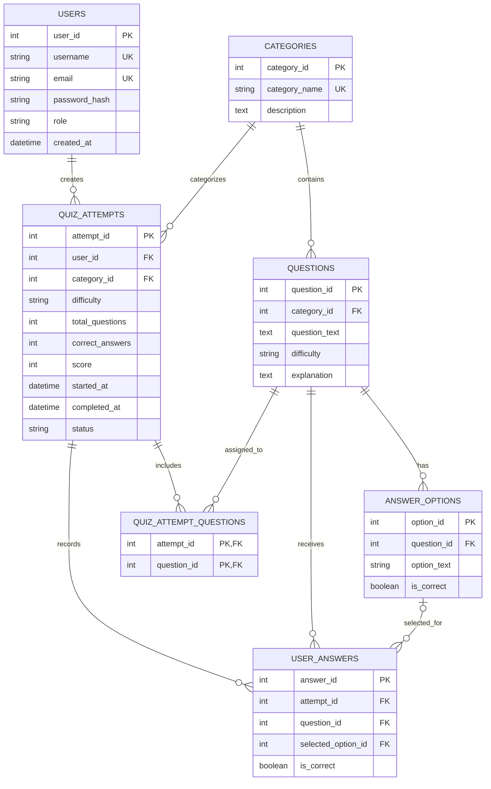

# QUIZFLIX
# DATABASE DESIGN AND ENTITY RELATIONSHIP DIAGRAM

**Project Name:** QuizFlix – Movie and Music Trivia Gaming Platform  
**Student Name:** Masoom Shaikh  
**Document:** Database Design and ER Diagram  
**Version:** 1.0  
**Date:** 8 November 2026

---

# 1. INTRODUCTION

## 1.1 Purpose

This document describes the database design of the QuizFlix application. It identifies the database tables, their attributes, primary keys, foreign keys, constraints, and relationships.

The document also presents the Entity Relationship Diagram (ERD) representing the relationships between the database entities.

## 1.2 Database Overview

QuizFlix uses MySQL as its relational database management system. SQLAlchemy is used as the Object Relational Mapper (ORM) to define database models and interact with the database.

The database consists of seven main tables:

1. `users`
2. `categories`
3. `questions`
4. `answer_options`
5. `quiz_attempts`
6. `user_answers`
7. `quiz_attempt_questions`

These tables support user management, quiz category management, question storage, quiz participation, answer submission, score recording, and quiz history.

---

# 2. ENTITY RELATIONSHIP DIAGRAM

The following ER diagram represents the database structure and the relationships between its seven entities.

## 2.1 Explanation of the ER Diagram

The diagram represents the following database structure:

- A user can create multiple quiz attempts.
- A category can contain multiple questions.
- A category can be associated with multiple quiz attempts.
- A question can have multiple answer options.
- A quiz attempt can contain multiple submitted answers.
- A question can appear in multiple user answer records.
- An answer option can be selected in multiple user answer records.
- A quiz attempt can contain multiple questions.
- A question can be assigned to multiple quiz attempts.

The `quiz_attempt_questions` table acts as a junction table to implement the many-to-many relationship between quiz attempts and questions.

The `selected_option_id` field in `user_answers` is nullable, allowing an answer record to exist without a selected option.

---

# 3. DATABASE TABLE DESCRIPTIONS

## 3.1 Users Table

**Table Name:** `users`

**Purpose:** Stores registered user information, login credentials, and user roles.

| Attribute | Data Type | Constraint / Description |
|---|---|---|
| user_id | Integer | Primary Key, Indexed |
| username | String(50) | Unique, Not Null, Indexed |
| email | String(120) | Unique, Not Null, Indexed |
| password_hash | String(255) | Not Null |
| role | String(20) | Default: user, Not Null |
| created_at | DateTime | Server default: current timestamp |

**Primary Key:** `user_id`

**Unique Constraints:** `username`, `email`

**Description:**

The users table stores account information for registered players and administrators. Passwords are stored as hashes rather than plain-text values.

The role field identifies the user's application role and supports role-based authorization.

## 3.2 Categories Table

**Table Name:** `categories`

**Purpose:** Stores the different trivia categories available in QuizFlix.

| Attribute | Data Type | Constraint / Description |
|---|---|---|
| category_id | Integer | Primary Key, Indexed |
| category_name | String(100) | Unique, Not Null |
| description | Text | Nullable |

**Primary Key:** `category_id`

**Unique Constraint:** `category_name`

**Description:**

The categories table stores the entertainment categories used for quiz participation.

The current categories include:

- Movies.
- Music.
- Web Series.
- Celebrities.

## 3.3 Questions Table

**Table Name:** `questions`

**Purpose:** Stores quiz questions, their associated categories, difficulty levels, and explanations.

| Attribute | Data Type | Constraint / Description |
|---|---|---|
| question_id | Integer | Primary Key, Indexed |
| category_id | Integer | Foreign Key referencing categories.category_id, Not Null |
| question_text | Text | Not Null |
| difficulty | String(20) | Not Null |
| explanation | Text | Nullable |

**Primary Key:** `question_id`

**Foreign Key:** `category_id` references `categories.category_id`.

**Relationship:** Each question belongs to a category.

**Description:**

The questions table stores the quiz questions available in the application.

Each question belongs to an entertainment category and has an associated difficulty level. An explanation can also be stored for answer review after quiz completion.

## 3.4 Answer Options Table

**Table Name:** `answer_options`

**Purpose:** Stores the multiple-choice options associated with each quiz question and identifies the correct option.

| Attribute | Data Type | Constraint / Description |
|---|---|---|
| option_id | Integer | Primary Key, Indexed |
| question_id | Integer | Foreign Key referencing questions.question_id, Not Null |
| option_text | String(500) | Not Null |
| is_correct | Boolean | Default: False, Not Null |

**Primary Key:** `option_id`

**Foreign Key:** `question_id` references `questions.question_id`.

**Relationship:** Each answer option belongs to a question.

**Description:**

The answer_options table stores the available choices for each multiple-choice question.

The `is_correct` field identifies whether an option represents the correct answer.

## 3.5 Quiz Attempts Table

**Table Name:** `quiz_attempts`

**Purpose:** Stores information about each quiz attempt made by a registered user.

| Attribute | Data Type | Constraint / Description |
|---|---|---|
| attempt_id | Integer | Primary Key |
| user_id | Integer | Foreign Key referencing users.user_id, Not Null |
| category_id | Integer | Foreign Key referencing categories.category_id, Not Null |
| difficulty | String(20) | Not Null |
| total_questions | Integer | Not Null |
| correct_answers | Integer | Default: 0, Not Null |
| score | Integer | Default: 0, Not Null |
| started_at | DateTime | Server default: current timestamp |
| completed_at | DateTime | Nullable |
| status | String(20) | Default: in_progress, Not Null |

**Primary Key:** `attempt_id`

**Foreign Keys:**

- `user_id` references `users.user_id`.
- `category_id` references `categories.category_id`.

**Relationship:** Each quiz attempt belongs to a user and a category.

**Description:**

The quiz_attempts table stores information about individual quiz sessions.

It maintains the number of questions, correct answers, score, difficulty level, timestamps, and completion status.

The records are also used to generate quiz results, dashboard statistics, leaderboard information, and personal quiz history.

## 3.6 User Answers Table

**Table Name:** `user_answers`

**Purpose:** Stores the answers submitted by users during individual quiz attempts.

| Attribute | Data Type | Constraint / Description |
|---|---|---|
| answer_id | Integer | Primary Key |
| attempt_id | Integer | Foreign Key referencing quiz_attempts.attempt_id, Not Null |
| question_id | Integer | Foreign Key referencing questions.question_id, Not Null |
| selected_option_id | Integer | Foreign Key referencing answer_options.option_id, Nullable |
| is_correct | Boolean | Default: False, Not Null |

**Primary Key:** `answer_id`

**Foreign Keys:**

- `attempt_id` references `quiz_attempts.attempt_id`.
- `question_id` references `questions.question_id`.
- `selected_option_id` references `answer_options.option_id`.

**Relationship:** Each answer record is associated with a quiz attempt and a question. The selected option may be nullable.

**Description:**

The user_answers table stores the answers submitted during quiz participation.

It records the related quiz attempt, question, selected answer option, and whether the submitted answer was correct.

## 3.7 Quiz Attempt Questions Table

**Table Name:** `quiz_attempt_questions`

**Purpose:** Records which questions are assigned to each quiz attempt.

| Attribute | Data Type | Constraint / Description |
|---|---|---|
| attempt_id | Integer | Composite Primary Key, Foreign Key |
| question_id | Integer | Composite Primary Key, Foreign Key |

**Composite Primary Key:** `(attempt_id, question_id)`

**Foreign Keys:**

- `attempt_id` references `quiz_attempts.attempt_id`.
- `question_id` references `questions.question_id`.

**Relationship:** This table connects quiz attempts and questions through a many-to-many relationship.

**Description:**

The junction table maintains the association between each quiz attempt and its assigned questions.

The composite primary key ensures that the same question cannot be assigned more than once to the same attempt through this table.

---

# 4. RELATIONSHIPS BETWEEN TABLES

The database contains the following relationships:

| Relationship | Type | Description |
|---|---|---|
| Users – Quiz Attempts | One-to-Many | One user can have multiple quiz attempts. |
| Categories – Questions | One-to-Many | One category can contain multiple questions. |
| Categories – Quiz Attempts | One-to-Many | One category can be associated with multiple quiz attempts. |
| Questions – Answer Options | One-to-Many | One question can have multiple answer options. |
| Quiz Attempts – User Answers | One-to-Many | One quiz attempt can contain multiple submitted answers. |
| Questions – User Answers | One-to-Many | A question can appear in multiple user answer records. |
| Answer Options – User Answers | One-to-Many | An answer option can be selected in multiple user answer records. |
| Quiz Attempts – Questions | Many-to-Many | A quiz attempt can contain multiple questions, and a question can be assigned to multiple attempts. |

The many-to-many relationship between `quiz_attempts` and `questions` is implemented using the `quiz_attempt_questions` junction table.

---

# 5. PRIMARY KEYS AND FOREIGN KEYS

## 5.1 Primary Keys

Primary keys uniquely identify records in their respective tables.

| Table | Primary Key |
|---|---|
| users | user_id |
| categories | category_id |
| questions | question_id |
| answer_options | option_id |
| quiz_attempts | attempt_id |
| user_answers | answer_id |
| quiz_attempt_questions | attempt_id, question_id |

The `quiz_attempt_questions` table uses a composite primary key consisting of both `attempt_id` and `question_id`.

## 5.2 Foreign Keys

Foreign keys establish relationships between tables and maintain referential integrity.

| Table | Foreign Key | References |
|---|---|---|
| questions | category_id | categories.category_id |
| answer_options | question_id | questions.question_id |
| quiz_attempts | user_id | users.user_id |
| quiz_attempts | category_id | categories.category_id |
| user_answers | attempt_id | quiz_attempts.attempt_id |
| user_answers | question_id | questions.question_id |
| user_answers | selected_option_id | answer_options.option_id |
| quiz_attempt_questions | attempt_id | quiz_attempts.attempt_id |
| quiz_attempt_questions | question_id | questions.question_id |

The `selected_option_id` foreign key in `user_answers` is nullable.

---

# 6. DATABASE DESIGN CONSIDERATIONS

The QuizFlix database follows a relational database structure in which related information is stored in separate tables.

The design provides the following benefits:

1. **Data Organization:** User details, categories, questions, options, and quiz records are stored separately.
2. **Referential Integrity:** Foreign keys connect related records across tables.
3. **Reduced Redundancy:** Reusable questions and categories are maintained independently of quiz attempts.
4. **Quiz Tracking:** Quiz attempts and submitted answers are stored for result retrieval and history.
5. **Many-to-Many Mapping:** The junction table records the questions assigned to each quiz attempt.
6. **Data Validation:** Unique constraints and non-null constraints are applied to selected fields.
7. **User Separation:** Quiz attempt records are associated with their respective users.

---

# 7. DATABASE TECHNOLOGIES

| Component | Technology |
|---|---|
| Database Management System | MySQL |
| Object Relational Mapper | SQLAlchemy |
| Backend Framework | FastAPI |
| Programming Language | Python |
| Database Connection | PyMySQL |

MySQL is responsible for persistent data storage, while SQLAlchemy provides an ORM-based interface for database operations.

FastAPI handles application requests and coordinates database-related operations.

---

# 8. CONCLUSION

The QuizFlix database is designed using a relational structure consisting of seven main tables. The tables maintain user information, quiz categories, questions, answer options, quiz attempts, submitted answers, and question assignments.

Primary keys and foreign keys establish relationships between entities, while the junction table supports the many-to-many relationship between quiz attempts and questions.

SQLAlchemy provides the ORM functionality, and MySQL is used for persistent data storage.

This database structure supports the core functionality of the QuizFlix Movie and Music Trivia Gaming Platform, including user authentication, quiz participation, score recording, answer review, leaderboard generation, and personal quiz history.

---

**END OF DOCUMENT**