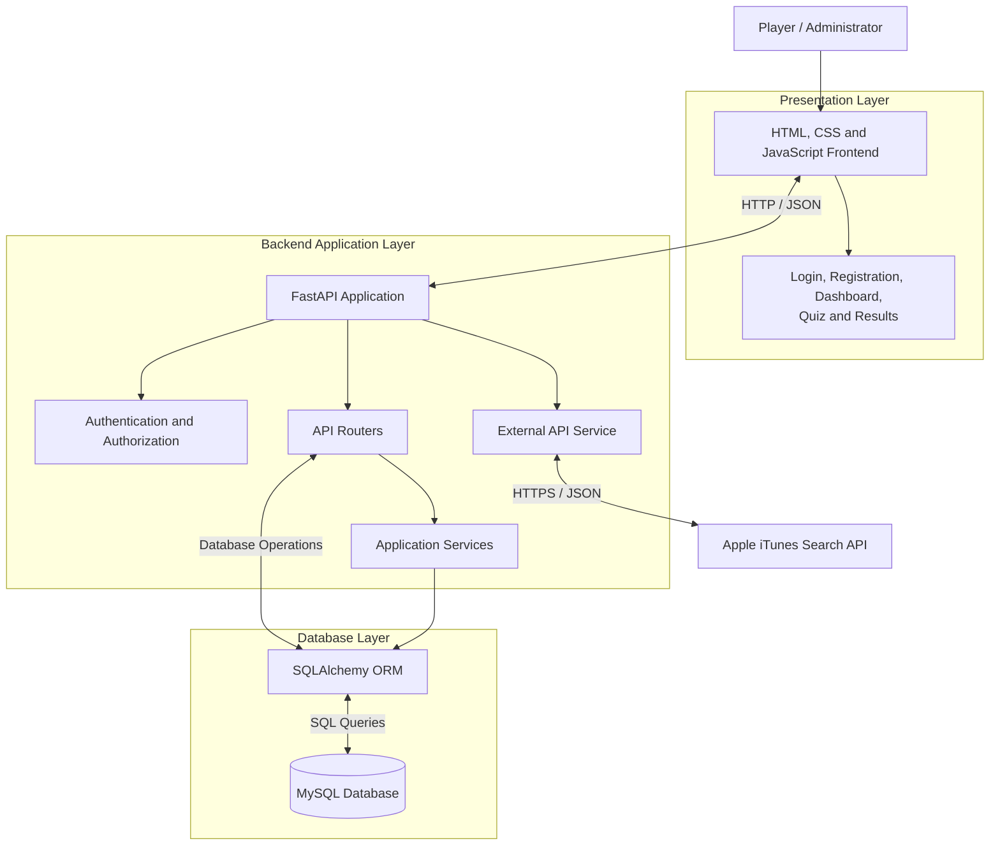
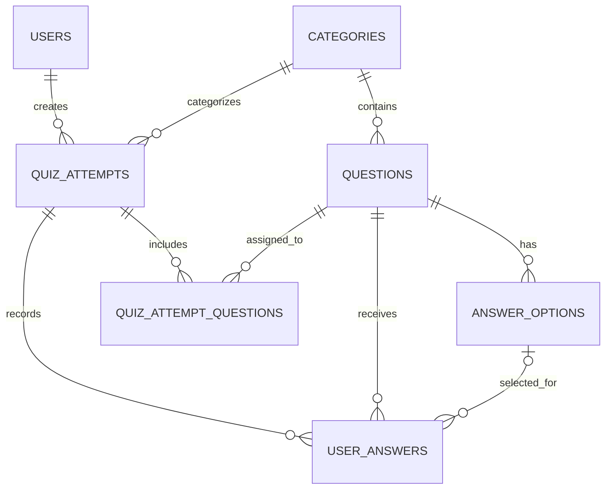

# QUIZFLIX
# MOVIE AND MUSIC TRIVIA GAMING PLATFORM

## SOFTWARE ENGINEERING PROJECT REPORT

**Submitted by:** Masoom Shaikh

**Project Type:** Software Engineering Assignment

**Project Title:** QuizFlix – Movie and Music Trivia Gaming Platform

**Institution:** Goa University

**Department:** MSc Integrated Data Science [3rd year]
**Academic Year:** 2026–2027

**Submission Date:** 17 November 2026

---

# ABSTRACT

QuizFlix is a web-based entertainment trivia gaming platform developed to provide an interactive environment where users can test their knowledge of movies, music, web series and celebrities through multiple-choice quizzes.

The application incorporates user registration, secure authentication, difficulty-based quizzes, randomized question selection, answer validation, automatic score calculation, accuracy measurement, answer reviews, quiz history and leaderboard functionality.

The frontend is developed using HTML, CSS and JavaScript, while the backend is implemented using Python and FastAPI. MySQL is used for persistent data storage, with SQLAlchemy providing Object Relational Mapping (ORM) functionality. JWT-based authentication and password hashing are implemented to protect user accounts and application endpoints.

The project also integrates the Apple iTunes Search API to retrieve external entertainment metadata. In addition to the main application, software engineering practices such as the V-Model SDLC, Test-Driven Development, automated testing using Pytest, Git version control and GitHub Actions Continuous Integration are incorporated.

Data analysis and machine-learning activities are included as supporting academic exercises. These demonstrations use simulated quiz-performance datasets and are separate from the application's live quiz data.

The project demonstrates the practical application of software engineering principles through the design, implementation, testing and documentation of a functional web-based trivia application.

**Keywords:** Quiz Application, FastAPI, Python, MySQL, SQLAlchemy, JWT, Software Engineering, Pytest, Continuous Integration.

---

# TABLE OF CONTENTS

1. Introduction
2. Problem Statement
3. Project Objectives
4. Project Scope
5. Software Development Life Cycle
6. Requirement Analysis
7. System Design and Architecture
8. Database Design
9. System Implementation
10. Testing and Validation
11. Data Analytics and Machine Learning
12. Performance Testing
13. Results and Discussion
14. Limitations
15. Future Scope
16. Conclusion
17. References
18. Appendices

---

# CHAPTER 1: INTRODUCTION

## 1.1 Introduction

Entertainment content such as movies, music, television series and celebrities has become an important part of modern digital culture. People frequently engage with entertainment-related information through digital platforms, social media and online communities.

QuizFlix is developed as an interactive trivia gaming platform that allows users to test their entertainment knowledge through multiple-choice quizzes.

The application provides questions across different entertainment categories and offers three difficulty levels: Easy, Medium and Hard.

Users can create accounts, log in, participate in quizzes, submit answers and view their results. The application also provides answer explanations, personal quiz history and a leaderboard.

The project combines frontend development, backend API development, relational database management, authentication, external API integration and software testing.

## 1.2 Background

Traditional quiz applications often focus on a limited set of subjects or provide basic question-and-answer functionality.

QuizFlix aims to provide a more organized entertainment trivia experience by incorporating:

- Multiple entertainment categories.
- Different quiz difficulty levels.
- Randomized question selection.
- Secure user authentication.
- Automatic scoring.
- Answer explanations.
- Personal performance history.
- Competitive leaderboard functionality.
- External entertainment metadata searches.

The application also serves as an academic project for demonstrating software engineering concepts and development practices.

## 1.3 Project Overview

QuizFlix follows a client-server architecture.

The frontend provides the interface through which users interact with the platform. The backend processes application requests, validates user input, performs business operations and communicates with the database.

MySQL stores user information, categories, questions, answer options, quiz attempts and submitted answers.

The application additionally communicates with the Apple iTunes Search API for external entertainment searches.

---

# CHAPTER 2: PROBLEM STATEMENT

Entertainment trivia is a popular form of interactive engagement. However, a simple collection of questions without user accounts, difficulty levels, performance tracking or answer explanations provides limited functionality.

A more structured platform is required to allow users to participate in entertainment quizzes, receive immediate feedback and track their performance.

The problem addressed by QuizFlix is the development of a web-based entertainment trivia platform that combines user authentication, category-based quizzes, automatic evaluation, performance tracking and external entertainment searches within a single application.

The system should provide a structured and accessible user experience while demonstrating reliable backend operations, database management and appropriate software testing practices.

---

# CHAPTER 3: PROJECT OBJECTIVES

The main objective of QuizFlix is to develop an interactive entertainment trivia gaming platform.

The specific objectives are:

1. To develop a web-based platform for movie, music, web series and celebrity trivia.
2. To implement secure user registration and authentication.
3. To organize questions into categories and difficulty levels.
4. To implement randomized question selection.
5. To support multiple-choice quiz participation.
6. To validate submitted answers on the backend.
7. To calculate scores and accuracy automatically.
8. To provide detailed answer reviews and explanations.
9. To maintain users' quiz history.
10. To provide a leaderboard based on quiz performance.
11. To implement administrative category and question management.
12. To integrate an external entertainment metadata API.
13. To demonstrate software engineering practices through documentation, automated testing and Continuous Integration.

---

# CHAPTER 4: PROJECT SCOPE

## 4.1 Functional Scope

The QuizFlix application includes the following functionality:

- User registration and login.
- Password hashing and JWT authentication.
- Movie, Music, Web Series and Celebrities categories.
- Easy, Medium and Hard difficulty levels.
- Randomized question selection.
- Multiple-choice questions.
- Server-side answer validation.
- Automatic score calculation.
- Accuracy percentage calculation.
- Answer review and explanations.
- Personal quiz history.
- Leaderboard retrieval.
- Administrative category management.
- Administrative question and answer-option management.
- External entertainment metadata searches.

## 4.2 Technical Scope

The technical scope includes:

- Frontend development using HTML, CSS and JavaScript.
- Backend development using Python and FastAPI.
- MySQL database integration.
- SQLAlchemy ORM.
- JWT authentication.
- Password hashing.
- REST-style API development.
- External API integration.
- Automated testing using Pytest.
- Data analysis using Pandas and NumPy.
- Data visualization using Matplotlib.
- Machine-learning demonstration using Scikit-learn.
- Version control using Git and GitHub.
- Continuous Integration using GitHub Actions.

## 4.3 Intended Users

### General Users

General users can register, log in, select categories, participate in quizzes, submit answers, view results and access their quiz history.

### Administrators

Administrators are responsible for maintaining application content. Their authorized operations include category management, question creation and answer-option management.

---

# CHAPTER 5: SOFTWARE DEVELOPMENT LIFE CYCLE

## 5.1 Selected SDLC Model

The V-Model, also known as the Verification and Validation Model, was selected as the Software Development Life Cycle methodology for QuizFlix.

The V-Model connects development activities with corresponding testing activities.

The major development stages are:

1. Requirements Analysis.
2. System Design.
3. High-Level Architecture Design.
4. Low-Level Module Design.
5. Coding and Implementation.

The corresponding testing stages are:

1. Unit Testing.
2. Integration Testing.
3. System Testing.
4. Acceptance Testing.

## 5.2 V-Model Mapping

| Development Phase | Corresponding Testing Phase |
|---|---|
| Requirements Analysis | Acceptance Testing |
| System Design | System Testing |
| High-Level Architecture Design | Integration Testing |
| Low-Level Module Design | Unit Testing |
| Coding and Implementation | Implementation point |

## 5.3 V-Model Application in QuizFlix

### Requirements Analysis

The functional and non-functional requirements were identified and documented in the Software Requirements Specification.

### System Design

The overall client-server architecture, database requirements and major application components were defined.

### High-Level Architecture Design

The backend was organized into models, routers, schemas, services and database configuration modules.

### Low-Level Module Design

Individual operations such as password verification, quiz validation, scoring and accuracy calculations were designed.

### Coding and Implementation

The application was developed using Python, FastAPI, MySQL, SQLAlchemy, HTML, CSS and JavaScript.

### Testing

Automated unit and API tests were created using Pytest. Functional and performance testing activities were also documented.

## 5.4 Test-Driven Development

Test-Driven Development was used as a complementary coding practice for the accuracy calculation functionality.

The process followed three stages:

**RED:** Tests were written before implementation and initially failed because the accuracy calculation function did not exist.

**GREEN:** The `calculate_accuracy()` function was implemented, allowing the tests to pass.

**REFACTOR:** The quiz result calculation was updated to reuse the accuracy function, followed by regression testing.

TDD complemented the V-Model and was not treated as a separate SDLC methodology.

---

# CHAPTER 6: REQUIREMENT ANALYSIS

## 6.1 Functional Requirements

The following functional requirements define the major operations supported by QuizFlix.

| ID | Functional Requirement |
|---|---|
| FR-01 | User Registration |
| FR-02 | User Login |
| FR-03 | User Profile Retrieval |
| FR-04 | Category Management |
| FR-05 | Question Management |
| FR-06 | Quiz Initiation |
| FR-07 | Multiple-Choice Questions |
| FR-08 | Answer Submission |
| FR-09 | Score Calculation |
| FR-10 | Quiz Results and Answer Review |
| FR-11 | Quiz History |
| FR-12 | Leaderboard |
| FR-13 | External API Integration |
| FR-14 | Authentication and Authorization |

## 6.2 Non-Functional Requirements

### Performance

The application should process user requests efficiently and provide reasonable response times under normal usage.

### Security

Passwords must be stored as hashes, protected endpoints must use JWT authentication, and administrative operations must require administrator authorization.

### Reliability

The system should handle invalid user input and external API failures appropriately.

### Usability

The user interface should provide clear navigation and understandable presentation of quiz questions and results.

### Maintainability

The backend should remain modular, and automated tests should help identify regressions.

## 6.3 Hardware and Software Requirements

### Hardware Requirements

The following represents the development environment requirements.

- Computer or laptop.
- Internet connectivity for external API access and GitHub operations.
- Sufficient memory and storage to run Python, MySQL and development tools.

### Software Requirements

| Software | Purpose |
|---|---|
| Windows | Development operating system |
| Python | Backend programming |
| FastAPI | Backend framework |
| MySQL | Relational database |
| Visual Studio Code | Development environment |
| Git | Version control |
| GitHub | Repository hosting |
| Pytest | Automated testing |
| Web Browser | Frontend execution |

---

# CHAPTER 7: SYSTEM DESIGN AND ARCHITECTURE

## 7.1 System Architecture

QuizFlix follows a layered client-server architecture.

The major architectural layers are:

1. Presentation Layer.
2. API and Application Layer.
3. Service Layer.
4. Data Access Layer.
5. Database Layer.
6. External Service Layer.

The frontend communicates with FastAPI through HTTP requests and JSON responses.

The backend processes requests, validates information, performs application operations and accesses MySQL through SQLAlchemy.

## 7.2 System Architecture Diagram



## 7.3 Frontend Design

The frontend is developed using HTML, CSS and JavaScript.

The application contains the following principal pages:

| File | Purpose |
|---|---|
| index.html | Login page |
| register.html | Registration page |
| dashboard.html | Dashboard and category navigation |
| quiz.html | Quiz participation |
| result.html | Quiz result and answer review |
| style.css | Shared styling |

JavaScript files handle frontend functionality and communication with backend endpoints.

## 7.4 Backend Design

The backend uses Python and FastAPI.

The main application entry point is:

`backend/app/main.py`

The backend follows a modular structure consisting of:

- Models.
- Routers.
- Schemas.
- Services.
- Database configuration.

The routers handle authentication, users, categories, questions, answer options, quizzes, leaderboard and external API searches.

## 7.5 API Design

The application exposes REST-style API endpoints.

The main endpoints include:

| HTTP Method | Endpoint | Purpose |
|---|---|---|
| POST | `/api/auth/register` | Register a user |
| POST | `/api/auth/login` | Authenticate a user |
| GET | `/api/users/me` | Retrieve current user |
| POST | `/api/quizzes/start` | Start a quiz |
| POST | `/api/quizzes/{attempt_id}/submit` | Submit quiz answers |
| GET | `/api/quizzes/history` | Retrieve quiz history |
| GET | `/api/leaderboard/` | Retrieve leaderboard |
| GET | `/api/external/search` | Search external entertainment content |

Additional category, question and answer-option endpoints are available through the FastAPI API documentation.

---

# CHAPTER 8: DATABASE DESIGN

## 8.1 Database Overview

MySQL is used as the primary relational database management system.

SQLAlchemy provides ORM functionality for database operations.

The database contains seven main tables:

1. users
2. categories
3. questions
4. answer_options
5. quiz_attempts
6. user_answers
7. quiz_attempt_questions

## 8.2 Database Entities

### Users

Stores registered user information, including username, email, password hash, role and account creation timestamp.

### Categories

Stores the entertainment categories available in the application.

### Questions

Stores quiz questions, their category relationships, difficulty levels and explanations.

### Answer Options

Stores multiple-choice answer options associated with individual questions.

### Quiz Attempts

Stores user quiz attempts, selected category, difficulty, total questions, correct answers, score, timestamps and attempt status.

### User Answers

Stores submitted answers and correctness information for individual quiz attempts.

### Quiz Attempt Questions

Connects quiz attempts and questions through a junction table.

## 8.3 Entity Relationship Diagram



## 8.4 Primary Keys and Foreign Keys

Primary keys uniquely identify records in the database.

Foreign keys maintain relationships between related records.

The `quiz_attempt_questions` table uses a composite primary key consisting of `attempt_id` and `question_id`.

## 8.5 Database Design Benefits

- Organized storage of application data.
- Reduced unnecessary duplication.
- Relationships between associated records.
- Support for multiple quiz attempts.
- Retrieval of individual user performance history.
- Structured management of questions and answer options.

The complete database design and entity descriptions are provided in `docs/database_design_and_erd.md`.

---

# CHAPTER 9: SYSTEM IMPLEMENTATION

## 9.1 Development Environment

The project was developed using Visual Studio Code.

The application uses a separate frontend and backend development environment.

The backend is executed using Uvicorn, while the frontend is served through Python's built-in HTTP server.

## 9.2 Backend Implementation

The backend is implemented using Python and FastAPI.

The main responsibilities include:

- User registration.
- User authentication.
- JWT token generation and validation.
- Category operations.
- Question management.
- Answer-option management.
- Quiz initiation.
- Answer submission.
- Result calculation.
- Quiz history.
- Leaderboard retrieval.
- External API integration.

## 9.3 Authentication Implementation

Passwords are hashed using Passlib and bcrypt.

During login, the submitted password is verified against the stored password hash.

After successful authentication, the backend generates a JWT access token.

Protected API endpoints validate the supplied bearer token to identify the authenticated user.

Administrative operations additionally check the user's role.

## 9.4 Quiz Generation

The quiz system allows users to select:

- Category.
- Difficulty level.
- Number of questions.

The backend retrieves matching questions and randomly selects questions for the quiz attempt.

The selected questions are associated with the created attempt through the `quiz_attempt_questions` table.

Correct-answer information is not exposed in the quiz-start response.

## 9.5 Answer Validation

When users submit answers, the backend validates:

- Quiz attempt ownership.
- Quiz completion status.
- Number of submitted answers.
- Duplicate question submissions.
- Assigned question identifiers.
- Validity of selected answer options.

This ensures that answer evaluation is performed by the backend rather than relying on frontend calculations.

## 9.6 Score and Accuracy Calculation

Each correct answer contributes 10 points.

The scoring formula is:

Score = Number of Correct Answers × 10

Accuracy is calculated using:

Accuracy (%) = (Correct Answers / Total Questions) × 100

For example, if a user answers 8 out of 10 questions correctly:

Score = 8 × 10 = 80

Accuracy = (8 / 10) × 100 = 80%

The calculation is performed through the backend scoring service.

## 9.7 Result Generation

After successful answer submission, the system generates a quiz result containing:

- Total questions.
- Correct answers.
- Score.
- Accuracy.
- Completion status.
- Selected answers.
- Correct answers.
- Available explanations.

The result is returned to the frontend for display.

## 9.8 External API Integration

QuizFlix integrates the Apple iTunes Search API.

The integration supports movie, music and television searches.

The backend receives a search query and media type, sends an HTTPS request to the external API and processes the returned JSON response.

The integration includes handling for invalid queries, request timeouts, connection errors and invalid response data.

## 9.9 Frontend Implementation

The frontend provides a user-friendly interface for interacting with the backend.

The major frontend modules are:

- Login.
- Registration.
- Dashboard.
- Quiz.
- Results.

JavaScript is used to submit requests, process responses and update the interface.

---

# CHAPTER 10: TESTING AND VALIDATION

## 10.1 Testing Overview

Testing is an important part of the QuizFlix development process.

The project uses Pytest and FastAPI TestClient for automated testing.

The tests verify authentication, quiz operations, score calculations, external API handling and CRUD functionality.

## 10.2 Testing Categories

### Unit Testing

Unit testing checks individual functions and application components.

The scoring service, authentication functionality and external API service are covered by automated tests.

### Integration Testing

Integration testing checks interactions between connected components such as routers, services, authentication dependencies and database operations.

### Functional Testing

Functional testing evaluates whether application features perform their expected operations.

### Performance Testing

Performance testing measures endpoint response times, throughput and request failures under sequential and concurrent requests.

### Continuous Integration Testing

GitHub Actions automatically installs dependencies and runs the automated test suite during configured GitHub events.

## 10.3 Automated Test Suite

The project contains the following test modules:

| Test File | Test Count |
|---|---:|
| test_auth.py | 7 |
| test_quizzes.py | 10 |
| test_scoring.py | 11 |
| test_tdd_scoring.py | 3 |
| test_external_api.py | 8 |
| test_crud_methods.py | 5 |
| **Total** | **44** |

## 10.4 Automated Test Results

The latest verified local test execution produced:

| Result | Count |
|---|---:|
| Passed | 44 |
| Failed | 0 |
| **Total** | **44** |

The test suite completed successfully.

One non-fatal Starlette deprecation warning involving the test client and HTTPX was reported during the verified execution.

## 10.5 Test-Driven Development Results

TDD was demonstrated through the development of the accuracy calculation function.

During the RED phase, tests failed because the function had not been implemented.

During the GREEN phase, implementation allowed the tests to pass.

During the REFACTOR phase, the scoring implementation was improved to reuse the accuracy calculation function.

Regression testing confirmed that existing scoring behaviour remained correct.

## 10.6 GitHub Actions Results

GitHub Actions was configured to execute the automated test suite.

The CI demonstration included an intentional test assertion error.

The workflow correctly failed when the incorrect assertion was pushed.

After correcting the assertion, the workflow completed successfully with all 44 tests passing.

This demonstrated the ability of Continuous Integration to identify test failures and verify corrections.

## 10.7 Test Environment

The automated API tests use temporary SQLite databases and dependency overrides for isolated testing.

The application itself is configured to use MySQL for persistent development data.

External API failure scenarios are tested using mocked responses to provide predictable and repeatable test conditions.

The detailed test cases are documented in `docs/functional_testing_report.md`.

---

# CHAPTER 11: DATA ANALYTICS AND MACHINE LEARNING

## 11.1 Overview

As part of the academic technical exercises associated with QuizFlix, data analytics and machine-learning demonstrations were implemented.

These activities demonstrate how quiz-performance data can be processed, analysed and used for predictive modelling.

The analytics and machine-learning datasets are simulated. They should not be interpreted as actual user performance collected from the live QuizFlix application.

## 11.2 Data Analytics

Pandas and NumPy were used to process and analyse quiz-performance data.

Matplotlib was used to generate visualizations.

The analytics exercise included:

- Loading CSV data.
- Inspecting dataset structure.
- Handling missing values.
- Identifying duplicate records.
- Cleaning the dataset.
- Calculating accuracy.
- Filtering records.
- Sorting performance results.
- Aggregating category and difficulty information.
- Generating visualizations.

## 11.3 Data Cleaning

The analytics dataset initially contained 22 records.

The analysis identified:

- One duplicate record.
- Three missing values.
- Missing duration values.
- A missing category value.

The duplicate record was removed, leaving 21 records.

Missing category values were assigned an Unknown category, while missing duration values were filled using the median duration of 110 seconds.

## 11.4 Analytics Results

The analysis produced the following summary:

| Metric | Result |
|---|---:|
| Initial records | 22 |
| Duplicate records removed | 1 |
| Records after duplicate removal | 21 |
| Mean score | 31.43 / 50 |
| Mean accuracy | 62.86% |

The generated visualizations include:

- `category_performance.png`
- `score_distribution.png`
- `difficulty_analysis.png`

The analysis script is maintained in:

`backend/analytics/analyze_quizflix.py`

## 11.5 Machine Learning Demonstration

A Decision Tree Classifier was implemented using Scikit-learn.

The objective was to demonstrate a classification model for predicting quiz difficulty based on simulated quiz-performance features.

The dataset was synthetically generated.

The initial dataset contained 360 records, with 120 records for each difficulty class.

After duplicate removal, 341 records remained.

The dataset was divided into training and testing subsets:

| Dataset | Records |
|---|---:|
| Training dataset | 255 |
| Testing dataset | 86 |
| Total cleaned records | 341 |

The model used a Decision Tree Classifier with a maximum depth of 4 and a minimum of 4 samples per leaf.

## 11.6 Machine Learning Results

The model achieved approximately 81.4% classification accuracy on the held-out test dataset.

The classification results were:

| Class | Precision | Recall | F1-Score |
|---|---:|---:|---:|
| Easy | 0.92 | 0.82 | 0.87 |
| Hard | 0.96 | 0.73 | 0.83 |
| Medium | 0.66 | 0.89 | 0.76 |
| **Accuracy** | | | **0.81** |

The most important features were:

| Feature | Importance |
|---|---:|
| Duration | 0.593441 |
| Accuracy | 0.406559 |

Correct-answer count and total-question count did not contribute additional feature importance in the fitted model.

Since the dataset is simulated, the model's accuracy should be interpreted only as a result of this academic demonstration rather than evidence of real-world predictive performance.

## 11.7 Generated Machine Learning Visualizations

The machine-learning exercise generated:

- `ml_difficulty_distribution.png`
- `ml_confusion_matrix.png`
- `ml_feature_importance.png`

The model implementation is maintained in:

`backend/analytics/data_science_model.py`

---

# CHAPTER 12: PERFORMANCE TESTING

## 12.1 Performance Testing Overview

Performance testing was performed to evaluate the response behaviour of selected QuizFlix API endpoints.

The tests measured sequential and concurrent requests.

The two endpoints used were:

- GET `/health`
- GET `/api/leaderboard/`

Each endpoint was tested with 100 requests under each execution mode.

The concurrency test used 10 workers.

## 12.2 Sequential Performance Results

| Endpoint | Requests | Successful | Average Response | P95 Response | Throughput |
|---|---:|---:|---:|---:|---:|
| Health | 100 | 100 | 19.63 ms | 27.97 ms | 50.46 req/s |
| Leaderboard | 100 | 100 | 24.39 ms | 35.61 ms | 40.71 req/s |

Both endpoints completed all 100 requests successfully during the sequential tests.

## 12.3 Concurrent Performance Results

| Endpoint | Requests | Successful | Average Response | P95 Response | Throughput |
|---|---:|---:|---:|---:|---:|
| Health | 100 | 100 | 11.13 ms | 18.89 ms | 736.4 req/s |
| Leaderboard | 100 | 100 | 69.86 ms | 217.60 ms | 138.82 req/s |

The concurrent tests also completed all 100 requests successfully for both endpoints.

## 12.4 Performance Discussion

The health endpoint showed a lower average response time during the concurrent test.

The leaderboard endpoint experienced higher average response time and variability under concurrent requests, which is consistent with the additional processing involved in retrieving leaderboard information.

These measurements represent a local development environment and a limited test workload. They should not be considered production-scale performance guarantees.

## 12.5 HTTP Method Testing

CRUD operations were tested using the API test environment.

The observed results included:

| HTTP Method | Status Code | Result |
|---|---:|---|
| GET | 200 | Successful |
| POST | 201 | Successful |
| PUT | 200 | Successful |
| DELETE | 200 | Successful |
| PATCH | 405 | Method not supported |

The results demonstrate the behaviour of the implemented CRUD routes and the handling of unsupported HTTP methods.

The detailed performance results are maintained in:

`docs/performance_testing_report.md`

---

# CHAPTER 13: RESULTS AND DISCUSSION

## 13.1 Project Outcomes

The QuizFlix project resulted in the implementation of a web-based entertainment trivia application.

The major outcomes include:

1. A functional frontend developed using HTML, CSS and JavaScript.
2. A FastAPI backend providing REST-style endpoints.
3. MySQL database integration.
4. Secure authentication using JWT.
5. Password hashing using Passlib and bcrypt.
6. Category-based quiz generation.
7. Randomized question selection.
8. Server-side answer validation.
9. Automated scoring and accuracy calculation.
10. Answer review and explanation functionality.
11. Quiz history and leaderboard functionality.
12. Administrative content management.
13. Apple iTunes Search API integration.
14. Automated testing using Pytest.
15. Continuous Integration using GitHub Actions.
16. Data analytics and machine-learning demonstrations.
17. Functional and performance testing documentation.

## 13.2 Testing Outcomes

The automated test suite recorded 44 passing tests with no failures in the latest verified local execution.

The GitHub Actions workflow also completed successfully.

The project demonstrated functional API operations, external API error handling, scoring calculations and CRUD behaviour through automated tests.

## 13.3 Analytical Outcomes

The analytics activity demonstrated data cleaning, duplicate handling, missing-value treatment, aggregation and visualization.

The machine-learning demonstration produced approximately 81.4% accuracy on a simulated held-out test dataset.

## 13.4 Overall Discussion

The results demonstrate the successful implementation of the principal application components and the application of software engineering practices.

The project combines web application development with database management, API integration, automated testing, analytics and version control.

However, the automated test results and local performance measurements should be interpreted within their respective test environments. Final browser-level acceptance testing remains a separate validation activity.

---

# CHAPTER 14: LIMITATIONS

Although QuizFlix implements its principal functionality, certain limitations remain.

1. The available question bank is limited and requires further expansion.
2. External entertainment searches depend on the availability of the third-party API.
3. The current performance measurements were obtained in a local development environment.
4. The analytics dataset contains simulated records rather than actual application usage data.
5. The machine-learning model was trained and evaluated using simulated data.
6. Frontend accessibility and browser-level testing can be expanded.
7. The application has not been evaluated as a production-scale deployment.
8. Additional monitoring, backup and deployment infrastructure may be required for a real-world production environment.

---

# CHAPTER 15: FUTURE SCOPE

The QuizFlix application can be extended in several ways.

## 15.1 Question Bank Expansion

Additional questions can be added across entertainment categories, languages, genres and difficulty levels.

## 15.2 Improved User Profiles

User profiles can provide detailed performance statistics, achievements and historical progress.

## 15.3 Additional Entertainment APIs

More external content providers can be integrated to increase the available entertainment metadata.

## 15.4 Advanced Analytics

Additional analytical dashboards can be implemented to examine user participation, question difficulty and category performance.

## 15.5 Recommendation Features

Future versions may include personalized quiz recommendations based on user interests and previous performance.

## 15.6 Deployment

The application can be deployed to a cloud-based environment with production database hosting, application monitoring and automated deployment.

## 15.7 Mobile Compatibility

The frontend can be further optimized for mobile devices and different screen sizes.

## 15.8 Enhanced Testing

Additional browser automation, accessibility testing, security testing and load testing can improve the overall quality of the application.

---

# CHAPTER 16: CONCLUSION

QuizFlix was developed as a web-based Movie and Music Trivia Gaming Platform that provides users with an interactive environment for testing their entertainment knowledge.

The project integrates frontend development, backend API development, relational database management, user authentication, quiz generation, automatic scoring, answer validation, external API integration and user performance tracking.

The application was developed using HTML, CSS, JavaScript, Python, FastAPI, SQLAlchemy and MySQL.

Software engineering practices were incorporated through the V-Model SDLC, Test-Driven Development, automated testing using Pytest, version control through Git and GitHub, and Continuous Integration using GitHub Actions.

The verified automated test suite achieved 44 passing tests. Additional functional testing, performance testing, data analytics and machine-learning demonstrations were also documented.

The project provided practical experience in software design, implementation, testing, documentation and version control.

Overall, QuizFlix demonstrates the application of software engineering principles in the development of an interactive entertainment trivia system and provides a foundation for future improvements and extensions.

---

# CHAPTER 17: REFERENCES

The following resources and project documents were used during the development and documentation of QuizFlix.

1. FastAPI Official Documentation – https://fastapi.tiangolo.com/
2. Python Official Documentation – https://docs.python.org/3/
3. MySQL Official Documentation – https://dev.mysql.com/doc/
4. SQLAlchemy Documentation – https://docs.sqlalchemy.org/
5. Pytest Documentation – https://docs.pytest.org/
6. Scikit-learn Documentation – https://scikit-learn.org/
7. Pandas Documentation – https://pandas.pydata.org/docs/
8. NumPy Documentation – https://numpy.org/doc/
9. Matplotlib Documentation – https://matplotlib.org/stable/
10. Apple iTunes Search API – https://developer.apple.com/library/archive/documentation/AudioVideo/Conceptual/iTuneSearchAPI/
11. GitHub Actions Documentation – https://docs.github.com/en/actions

## Project Repository

GitHub Repository:

https://github.com/masoomshaikhh/QuizFlix

---

# CHAPTER 18: APPENDICES

## APPENDIX A: PROJECT DIRECTORY STRUCTURE

The main project structure is organized as follows:

```text
QuizFlix/
│
├── backend/
│   │
│   ├── app/
│   │   ├── models/
│   │   ├── routers/
│   │   ├── schemas/
│   │   ├── services/
│   │   ├── config.py
│   │   ├── database.py
│   │   └── main.py
│   │
│   ├── tests/
│   │   ├── test_auth.py
│   │   ├── test_crud_methods.py
│   │   ├── test_external_api.py
│   │   ├── test_quizzes.py
│   │   ├── test_scoring.py
│   │   └── test_tdd_scoring.py
│   │
│   ├── analytics/
│   │
│   ├── requirements.txt
│   ├── create_tables.py
│   ├── seed_questions.py
│   └── seed_questions_batch2.py
│
├── frontend/
│   ├── index.html
│   ├── register.html
│   ├── dashboard.html
│   ├── quiz.html
│   ├── result.html
│   ├── style.css
│   └── JavaScript files
│
├── docs/
│   ├── SRS.md
│   ├── sdlc_v_model.md
│   ├── system_architecture.md
│   ├── database_design_and_erd.md
│   ├── functional_testing_report.md
│   ├── performance_testing_report.md
│   └── final_project_report.md
│
├── .github/
│   └── workflows/
│       └── ci.yml
│
├── .gitignore
└── README.md
```

## APPENDIX B: EXECUTION INSTRUCTIONS

### Step 1: Clone the Repository

```bash
git clone https://github.com/masoomshaikhh/QuizFlix.git
cd QuizFlix
```

### Step 2: Create a Virtual Environment

```bash
python -m venv venv
```

### Step 3: Activate the Virtual Environment

For Windows PowerShell:

```powershell
Set-ExecutionPolicy -Scope Process -ExecutionPolicy Bypass -Force
.\venv\Scripts\Activate.ps1
```

### Step 4: Install Dependencies

```bash
pip install -r backend/requirements.txt
```

### Step 5: Configure the Database

Create the MySQL database:

```sql
CREATE DATABASE quizflix_db;
```

Configure the database connection and secret key in the root `.env` file according to the application configuration.

Do not upload actual database credentials or secret keys to GitHub.

### Step 6: Create Database Tables

```bash
python -m backend.create_tables
```

### Step 7: Populate Quiz Questions

```bash
python -m backend.seed_questions
python -m backend.seed_questions_batch2
```

### Step 8: Start the Backend

```bash
uvicorn backend.app.main:app --reload
```

Backend:

http://127.0.0.1:8000

API Documentation:

http://127.0.0.1:8000/docs

### Step 9: Start the Frontend

Open another terminal:

```powershell
cd frontend
python -m http.server 5500
```

Frontend:

http://127.0.0.1:5500/index.html

## APPENDIX C: AUTOMATED TEST EXECUTION

To execute the automated test suite:

```bash
python -m pytest -v
```

The latest verified local execution recorded:

**44 passed, 0 failed.**

---

**END OF QUIZFLIX PROJECT REPORT**