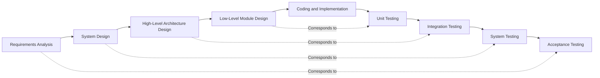

# QUIZFLIX
# SOFTWARE DEVELOPMENT LIFE CYCLE – V-MODEL

**Project:** QuizFlix – Movie and Music Trivia Gaming Platform  
**Student:** Masoom Shaikh  
**SDLC Methodology:** V-Model  
**Document Version:** 1.0  
**Date:** 8 November 2026

---

# 1. INTRODUCTION

## 1.1 Overview

The Software Development Life Cycle (SDLC) defines a structured process for developing, testing and maintaining software applications.

QuizFlix uses the V-Model as its SDLC framework. The V-Model links each development phase to a corresponding testing phase. Verification activities are considered during development, while validation activities are performed as the implemented system is tested.

## 1.2 Objectives

The objectives of using the V-Model for QuizFlix are to:

1. Define the system requirements clearly.
2. Organise development into identifiable phases.
3. Plan testing activities alongside development activities.
4. Maintain traceability between requirements, design decisions and tests.
5. Verify that the implemented application meets its specified requirements.

# 2. WHY THE V-MODEL WAS SELECTED

The V-Model provides a structured process that is suitable for documenting the requirements, design, implementation and testing of QuizFlix. It makes the relationship between development activities and their corresponding testing activities explicit.

The project uses the V-Model as its SDLC framework. Test-Driven Development (TDD) was also used as a complementary coding practice for the scoring functionality; it is not a separate SDLC model in this project.

# 3. V-MODEL REPRESENTATION

The following diagram shows the development and testing phases used to organise QuizFlix.

The corresponding development and testing phases are:

| Development Phase | Corresponding Testing Phase |
|---|---|
| Requirements Analysis | Acceptance Testing |
| System Design | System Testing |
| High-Level Architecture Design | Integration Testing |
| Low-Level Module Design | Unit Testing |
| Coding and Implementation | Implementation point between development and testing |

# 4. DEVELOPMENT PHASES

## 4.1 Requirements Analysis

This phase identifies the expected functions and constraints of QuizFlix.

The requirements include:

- User registration and login.
- Entertainment categories: Movies, Music, Web Series and Celebrities.
- Easy, Medium and Hard quiz difficulty levels.
- Random question selection.
- Multiple-choice answer submission and server-side validation.
- Score and accuracy calculation.
- Result review and explanations.
- Quiz history and leaderboard.
- Administrative category and question management.
- External entertainment metadata search.

The Software Requirements Specification (SRS) records the functional and non-functional requirements.

**Corresponding Test Level:** Acceptance testing, which checks whether the delivered system meets user and project requirements.

## 4.2 System Design

This phase defines the overall system structure and the way major parts interact.

QuizFlix uses a client-server structure with:

- A frontend developed using HTML, CSS and JavaScript.
- A backend developed using Python and FastAPI.
- A MySQL relational database.
- SQLAlchemy for database access.
- JWT-based authentication for protected endpoints.
- An external API integration for entertainment metadata searches.

**Corresponding Test Level:** System testing, which checks the integrated application against its system-level requirements.

## 4.3 High-Level Architecture Design

This phase identifies the major application modules and their interactions.

The backend is organised into models, routers, schemas and services, with database configuration and authentication dependencies. The application also has analytics and external API integration modules.

**Corresponding Test Level:** Integration testing, which checks communication and data flow between connected modules.

## 4.4 Low-Level Module Design

This phase describes the internal behaviour of individual modules and functions.

Examples in QuizFlix include:

- Password hashing and verification.
- JWT token creation and validation.
- Random quiz question selection.
- Submitted question and answer-option validation.
- Score and accuracy calculation.
- Leaderboard aggregation.
- External API response processing and error handling.

**Corresponding Test Level:** Unit testing, which checks individual functions and modules.

## 4.5 Coding and Implementation

The design was implemented using the following technologies:

| Component | Technology |
|---|---|
| Frontend | HTML, CSS and JavaScript |
| Backend | Python and FastAPI |
| Database | MySQL |
| ORM | SQLAlchemy |
| Authentication | JWT |
| Password Security | Passlib and bcrypt |
| Automated Testing | Pytest |
| Version Control | Git and GitHub |
| Continuous Integration | GitHub Actions |

The implementation converts the approved requirements and design into working application components.

# 5. TESTING PHASES

## 5.1 Unit Testing

Unit tests verify individual functions and modules.

QuizFlix unit tests cover scoring and accuracy calculations, authentication-related behaviour, quiz validation and external API service behaviour.

Pytest is used as the testing framework.

The latest verified local test run reported:

**44 tests passed, 0 failed.**

The GitHub Actions workflow also completed successfully with 44 tests in the verified run.

## 5.2 Integration Testing

Integration testing checks interactions between connected application components.

Areas addressed through the implementation and automated tests in QuizFlix include:

- FastAPI routers and database operations.
- Quiz attempts and answer submission.
- Authentication dependencies and protected endpoints.
- The external API router and its service layer.
- CRUD operations involving application data.

Frontend and backend API communication is also part of the final browser-level verification.

## 5.3 System Testing

System testing evaluates the integrated application against its system requirements.

The project test activities cover:

- Registration and login.
- Category retrieval.
- Quiz creation.
- Answer submission.
- Result generation.
- Quiz history.
- Leaderboard retrieval.
- External entertainment searches.

Functional and performance testing activities are documented in separate reports.

## 5.4 Acceptance Testing

Acceptance testing considers whether the application supports the intended user workflows.

The main workflows identified for final user-level verification are:

1. A user registers and logs in.
2. The user selects a quiz category and difficulty.
3. The user starts and completes a quiz.
4. The system validates submitted answers and calculates the result.
5. The user reviews the score and answer explanations.
6. The user views quiz history and the leaderboard.

These workflows should be checked through the application interface as part of the final acceptance review.

# 6. TEST-DRIVEN DEVELOPMENT

TDD was used as a complementary development practice for the accuracy calculation functionality.

## 6.1 RED Phase

Tests were written for the `calculate_accuracy()` function before the function was implemented.

The tests initially failed because the function did not yet exist.

## 6.2 GREEN Phase

The `calculate_accuracy()` function was implemented in the scoring service.

The new tests then passed.

## 6.3 REFACTOR Phase

The quiz result calculation was updated to reuse the accuracy function.

Regression tests were run to check that existing scoring behaviour remained correct.

TDD complemented the V-Model development process; it was not treated as a separate SDLC methodology.

# 7. CONTINUOUS INTEGRATION

GitHub Actions is configured in `.github/workflows/ci.yml` to install project dependencies and run the Pytest suite.

The workflow is configured to run on:

- Pushes to the `main` branch.
- Pull requests targeting the `main` branch.

The CI demonstration included an intentional test assertion error. The workflow failed when the incorrect assertion was pushed.

After the assertion was restored, the subsequent workflow completed successfully with 44 tests passing.

This demonstrates how Continuous Integration helps identify errors and verify corrections through automated testing.

# 8. ADVANTAGES OF THE V-MODEL

The V-Model supports QuizFlix development through:

1. Clearly defined development and testing phases.
2. Early consideration of test requirements.
3. Traceability between requirements and test activities.
4. A structured approach to verification and validation.
5. Documentation of the design and testing process.

# 9. LIMITATIONS

The V-Model also has limitations:

- Changes to requirements can require revisions to related design and test activities.
- The model is less flexible than iterative approaches when requirements change frequently.
- Each phase requires planning and documentation.
- Rework may be needed if a requirement changes after dependent stages have been completed.

# 10. CONCLUSION

The V-Model provides the SDLC structure used to organise QuizFlix requirements analysis, system design, architecture design, module design, coding and corresponding testing activities.

Pytest supports automated verification, while GitHub Actions automates execution of the test suite during the configured Git workflow.

The use of the V-Model, supported by TDD and Continuous Integration, provides a structured approach to developing and testing the QuizFlix Movie and Music Trivia Gaming Platform.

---

**END OF DOCUMENT**