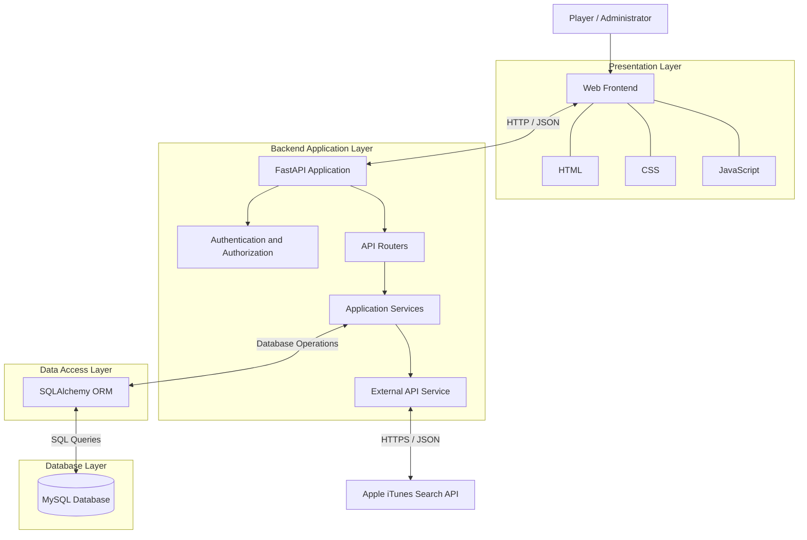

# QUIZFLIX
# SYSTEM ARCHITECTURE DOCUMENT

**Project Name:** QuizFlix – Movie and Music Trivia Gaming Platform  
**Student Name:** Masoom Shaikh  
**Document Version:** 1.0  
**Date:** 8 November 2026

---

# 1. INTRODUCTION

## 1.1 Purpose

This document describes the system architecture of QuizFlix. It explains the application's major components, their responsibilities, the technologies used, and the interactions between the frontend, backend, database, and external services.

## 1.2 Scope

QuizFlix is a web-based entertainment trivia gaming platform that allows users to participate in multiple-choice quizzes based on movies, music, web series, and celebrities.

The system provides:

- User registration and login.
- Authentication and authorization.
- Entertainment category management.
- Difficulty-based quiz generation.
- Randomized question selection.
- Multiple-choice answer submission.
- Automatic score and accuracy calculation.
- Answer review and explanations.
- Personal quiz history.
- Leaderboard functionality.
- Administrative content management.
- External entertainment metadata search.

The application supports four main quiz categories:

1. Movies.
2. Music.
3. Web Series.
4. Celebrities.

# 2. ARCHITECTURAL OVERVIEW

QuizFlix follows a client-server architecture. The frontend communicates with the FastAPI backend through HTTP requests and receives JSON responses.

The backend handles authentication, application logic, quiz operations, scoring, and database communication. MySQL provides persistent storage, while SQLAlchemy is used for database interaction.

The application also integrates the Apple iTunes Search API to retrieve external entertainment metadata.

The architecture is divided into the following layers:

1. Presentation Layer.
2. API and Application Layer.
3. Service Layer.
4. Data Access Layer.
5. Database Layer.
6. External Service Layer.

# 3. SYSTEM ARCHITECTURE DIAGRAM

The following diagram represents the overall architecture of QuizFlix.

# 4. ARCHITECTURAL COMPONENTS

## 4.1 Presentation Layer

The presentation layer provides the graphical user interface through which users interact with QuizFlix.

It is developed using:

- HTML for webpage structure.
- CSS for styling and layout.
- JavaScript for client-side functionality and API communication.

The frontend provides the following interfaces:

- Login page for user authentication.
- Registration page for new account creation.
- Dashboard for category selection, user information, statistics and leaderboard.
- Quiz interface for displaying questions and answer options.
- Result interface for displaying scores and answer reviews.
- Quiz History section for displaying previous quiz attempts.

The dashboard also provides a refresh option for retrieving updated quiz history records.

## 4.2 API and Application Layer

The backend application is developed using Python and FastAPI.

The main application entry point is:

`backend/app/main.py`

The FastAPI application registers the API routers and configures application-level middleware.

The backend contains routers responsible for:

- Authentication.
- User operations.
- Category management.
- Question management.
- Answer-option management.
- Quiz operations.
- Quiz history.
- Leaderboard retrieval.
- External API searches.

These routers receive incoming requests, validate inputs, execute application operations, and return appropriate JSON responses.

## 4.3 Authentication and Authorization

QuizFlix uses JSON Web Tokens (JWT) for authentication.

The authentication system includes:

- User registration.
- Password hashing.
- Password verification.
- Login authentication.
- JWT access-token generation.
- Protected endpoint authorization.
- Administrator role verification.

Passlib and bcrypt are used for password hashing.

Passwords are stored as hashes rather than plain-text values.

Authenticated requests use bearer-token authentication to access protected endpoints.

## 4.4 Service Layer

The service layer contains reusable application logic.

The main service responsibilities include:

**Authentication Service**

Handles password hashing, password verification, and JWT access-token creation.

**Scoring Service**

Calculates quiz scores and accuracy percentages based on submitted answers.

The scoring implementation includes:

- Correct-answer validation.
- Score calculation.
- Accuracy calculation.
- Quiz result generation.

Each correct answer contributes 10 points.

**External API Service**

Communicates with the Apple iTunes Search API using Python Requests.

It processes external JSON responses and handles errors such as request timeouts, connection failures, and invalid responses.

## 4.5 Data Access Layer

SQLAlchemy is used as the Object Relational Mapper (ORM).

The data access layer provides:

- Database engine configuration.
- Database session management.
- SQLAlchemy model definitions.
- Database queries and operations.
- Relationships between database entities.

The database configuration and session management are maintained in the backend database module.

## 4.6 Database Layer

MySQL is used as the relational database management system.

The QuizFlix database contains seven main tables:

| Table Name | Purpose |
|---|---|
| users | Stores registered user information and authentication details. |
| categories | Stores entertainment quiz categories. |
| questions | Stores quiz questions and associated category information. |
| answer_options | Stores multiple-choice answer options. |
| quiz_attempts | Stores individual quiz attempt information and results. |
| user_answers | Stores submitted answers and correctness information. |
| quiz_attempt_questions | Records which questions are assigned to each quiz attempt. |

Primary keys and foreign keys establish relationships between the entities.

The database structure supports user authentication, category management, question retrieval, quiz attempts, answer storage, result generation and personal quiz history.

The database structure is documented separately in:

`docs/database_design_and_erd.md`

## 4.7 External Service Layer

QuizFlix integrates the Apple iTunes Search API for external entertainment searches.

The external API integration supports:

- Movie searches.
- Music searches.
- Television searches.

The backend sends HTTPS requests to the external service and processes the returned JSON data.

The integration includes request validation, timeout handling, and error responses.

# 5. DATA FLOW

## 5.1 User Registration and Login Flow

1. The user opens the QuizFlix frontend.
2. The user enters registration or login information.
3. The frontend sends an HTTP request to the authentication endpoint.
4. The backend validates the submitted information.
5. During registration, the password is hashed before database storage.
6. During login, the submitted password is verified against the stored password hash.
7. Following successful authentication, the backend generates a JWT access token.
8. The frontend uses the access token for protected API requests.
9. The authenticated user is redirected to the dashboard.

## 5.2 Quiz Participation Flow

1. The authenticated user selects a quiz category.
2. The user selects a difficulty level.
3. The frontend sends the quiz-start request to the backend.
4. The backend validates the request and retrieves matching questions.
5. A quiz attempt is created and the assigned questions are recorded.
6. The selected questions and answer options are returned to the frontend.
7. The user selects answers and submits the completed quiz.
8. The backend validates the submitted answers and quiz attempt.
9. The scoring service calculates the score and accuracy.
10. The backend stores the submitted answers and completed attempt information.
11. The result is returned to the frontend for display.
12. The dashboard statistics and quiz history can then reflect the completed attempt.

The currently browser-tested quiz flow presents four questions per attempt.

## 5.3 Quiz History Flow

1. The authenticated user opens the dashboard.
2. The user navigates to the Quiz History section.
3. The frontend sends an authenticated request to the quiz history endpoint.
4. The backend identifies the authenticated user.
5. The backend retrieves the user's previous quiz attempts from the database.
6. The attempt records are returned to the frontend in JSON format.
7. The frontend displays the records in a history table.
8. The user can refresh the history to retrieve updated records.

Quiz history is restricted to the authenticated user's own attempts.

## 5.4 Leaderboard Flow

1. The user opens the leaderboard section on the dashboard.
2. The frontend sends a request to the leaderboard endpoint.
3. The backend retrieves the relevant quiz performance information.
4. The backend processes the leaderboard data.
5. The ranking information is returned to the frontend.
6. The frontend displays player rankings and performance details.

## 5.5 External API Search Flow

1. The user or frontend initiates an entertainment search.
2. The frontend sends a request to the external API endpoint.
3. The backend validates the search term and media type.
4. The external API service sends a request to the Apple iTunes Search API.
5. The external service returns a JSON response.
6. The backend processes the response and prepares structured results.
7. The results are returned to the frontend.
8. Any external API errors are handled and returned through appropriate API responses.

# 6. TECHNOLOGY STACK

The following technologies are used in the QuizFlix application:

| Component | Technology |
|---|---|
| Frontend | HTML, CSS, JavaScript |
| Backend Programming Language | Python |
| Backend Framework | FastAPI |
| Database | MySQL |
| Object Relational Mapper | SQLAlchemy |
| Database Driver | PyMySQL |
| Authentication | JSON Web Tokens (JWT) |
| Password Hashing | Passlib and bcrypt |
| HTTP Requests | Python Requests |
| External API | Apple iTunes Search API |
| Automated Testing | Pytest |
| Data Analysis | Pandas and NumPy |
| Data Visualization | Matplotlib |
| Machine Learning | Scikit-learn |
| Version Control | Git and GitHub |
| Continuous Integration | GitHub Actions |

## 6.1 Data Science and Machine Learning Components

The project also includes academic data analysis and machine-learning demonstrations.

These components use:

- Pandas and NumPy for data processing.
- Matplotlib for data visualization.
- Scikit-learn for machine-learning implementation.
- A Decision Tree model for the quiz-performance classification demonstration.

The analytics and machine-learning demonstrations use simulated quiz-performance data. They are supporting academic components and are separate from the main live quiz request flow.

# 7. DEPLOYMENT AND EXECUTION ENVIRONMENT

During local development, the QuizFlix backend is executed using Uvicorn.

The frontend is served separately using Python's built-in HTTP server.

The local development addresses are:

| Component | Address |
|---|---|
| Frontend | http://127.0.0.1:5500 |
| Backend | http://127.0.0.1:8000 |
| FastAPI Documentation | http://127.0.0.1:8000/docs |

The backend connects to the MySQL database using configuration values stored in environment variables.

Sensitive configuration values, including database credentials and the JWT secret key, are maintained in the environment file and excluded from Git version control.

# 8. SECURITY CONSIDERATIONS

The architecture incorporates the following security measures:

1. Passwords are hashed before database storage.
2. JWT-based authentication protects authenticated endpoints.
3. Administrator operations require administrator authorization.
4. Database credentials and secret keys are stored in environment variables.
5. Environment files are excluded from version control.
6. Quiz submissions are validated on the backend.
7. Quiz attempts are checked against the authenticated user.
8. Selected answer options are validated against their associated questions.
9. External API requests use timeout and error-handling mechanisms.

# 9. TESTING AND CONTINUOUS INTEGRATION

QuizFlix uses Pytest for automated backend testing.

The automated tests cover:

- Authentication and registration.
- Quiz operations.
- Answer submission.
- Score and accuracy calculation.
- External API integration.
- CRUD operations.
- Quiz history and related functionality.

The latest verified local test execution recorded:

**44 tests passed, 0 failed.**

The automated test suite uses temporary SQLite databases for relevant isolated tests, while MySQL is used as the application's primary persistent development database.

GitHub Actions is configured to install project dependencies and execute the automated test suite when changes are pushed to the main branch or when pull requests target the main branch.

The project also includes separate functional and performance testing reports.

# 10. CONCLUSION

QuizFlix uses a layered client-server architecture that separates the presentation, application, service, data access, and database responsibilities.

The FastAPI backend coordinates authentication, quiz operations, scoring, and external API integration. SQLAlchemy manages interactions with the MySQL database, while the HTML, CSS, and JavaScript frontend provides the user interface.

The architecture supports important application features such as user authentication, four entertainment quiz categories, quiz history, leaderboard functionality and automated score calculation.

The additional data science and machine-learning components demonstrate the use of analytical techniques alongside the main software application.

This architecture supports modular development, testing, maintenance, and future improvements to the QuizFlix Movie and Music Trivia Gaming Platform.

---

**END OF DOCUMENT**